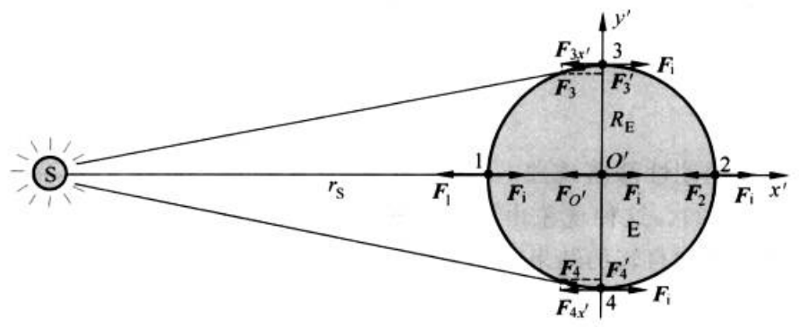

# 第2章 运动与力

> 非连续样本；缺页不补写。

# PDF 第 80 页

章节：第2章 运动与力；节：2.7 潮汐。印刷页码：64。

[原页截图](../assets/p0080.png)。文字和 LaTeX 为机器识别，引用前请核对原图。

64

[区域原图](../assets/p0080-b000.png)

第
章
运
动
与
力

[区域原图](../assets/p0080-b001.png)

选地心参考系的x和y轴分别与太阳参考系的x轴和y轴平行，在地心参考系内的情况如
图2.24所示，其中各处惯性力均与x轴平行。

[区域原图](../assets/p0080-b002.png)

**figure：原图保留，表格未重建**

3
F3
F'
RE
0'
S
2
's
F
F;Fo
F
F2
Fi
E
F4
F4
F
F4x
4

图2.24
地心参考系内的太阳引力和惯性力

[区域原图](../assets/p0080-b004.png)

先考虑地心O处一小块质量为△m的物质。它受的惯性力为

[区域原图](../assets/p0080-b005.png)

**公式待复核**

$$
F_{i}\,=\,\Delta m\omega^{2}\,r_{s}\,,
$$

[区域原图](../assets/p0080-b006.png)

原书公式编号（人工核对）：2.32

(2.
32

[区域原图](../assets/p0080-b007.png)

它受太阳的引力
为

[区域原图](../assets/p0080-b008.png)

**公式待复核**

$$
F_{o^{\prime}}={\frac{G M_{\mathrm{S}}\Delta m}{r_{\mathrm{S}}^{2}}}\mathrm{e}\bar{\Gamma}_{\mathrm{S}}^{2}\mathrm{e}^{2}
$$

[区域原图](../assets/p0080-b009.png)

原书公式编号（人工核对）：2.33

(2
33

[区域原图](../assets/p0080-b010.png)

其中M为太阳的质量。它还受到地球本身其他部分的力（引力和化学结合力，主要是引
力），但由于球对称性，这些力的合力为零。这样，由于△m在地心参考系中静止，所以F和
F相互平衡。因而有

[区域原图](../assets/p0080-b011.png)

**公式待复核**

$$
F_{i}\,=\,\Delta m\,\omega^{2}r_{\mathrm{s}}\,=\,\frac{G M_{\mathrm{s}}\Delta m}{r_{\mathrm{s}}^{2}}
$$

[区域原图](../assets/p0080-b012.png)

原书公式编号（人工核对）：2.34

(2
34

[区域原图](../assets/p0080-b013.png)

球表面离太阳最近的“1"处的质量为△m的海水。它受的太阳的引力为

[区域原图](../assets/p0080-b014.png)

**公式待复核**

$$
F_{1}={\frac{G M_{\mathrm{S}}\Delta m}{F_{S}-R_{F}-R_{F}}}.
$$

[区域原图](../assets/p0080-b015.png)

由于RE《rs，取一级近似，上式可写成

[区域原图](../assets/p0080-b016.png)

**公式待复核**

$$
F_{1}={\frac{G M_{\mathrm{S}}\Delta m}{r_{\mathrm{S}}^{2}}}\Big(1+{\frac{2R_{\mathrm{E}}}{r_{\mathrm{S}}^{2}}}\Big)
$$

[区域原图](../assets/p0080-b017.png)

原书公式编号（人工核对）：2.35

(2.
35
5

[区域原图](../assets/p0080-b018.png)

此处△m海水所受惯性力仍由式（2.34）给出。将F和F：相比可知F较大，视其差值为一
力，其大小为

[区域原图](../assets/p0080-b019.png)

**公式待复核**

$$
F_{1}^{\prime}=F_{1}-F_{i}={\frac{2G M_{\mathrm{S}}\Delta m}{r_{\mathrm{S}}^{3}}}R_{\mathrm{E}}^{\prime}
$$

[区域原图](../assets/p0080-b020.png)

原书公式编号（人工核对）：2.36

(2.
36

[区域原图](../assets/p0080-b021.png)

方向背离地心。这就是在地球上观察到的“引潮力”，它将使此处海水凸起形成涨潮，直到地
球其他部分对△m的指向地心的力和这一引潮力平衡为止。

[区域原图](../assets/p0080-b022.png)

再考虑地球表面离太阳最远的“2”处的质量为△m的海水。它受太阳的引力为

[区域原图](../assets/p0080-b023.png)

**公式待复核**

$$
F_{z}={\frac{G M_{\mathrm{S}}\Delta m}{(r_{\mathrm{S}}+R_{\mathrm{S}})^{\mathrm{T}}(r_{\mathrm{S}}(r_{\mathrm{S}}+R_{\mathrm{S}}+R_{\mathrm{S}})}}
$$

[区域原图](../assets/p0080-b024.png)

仍取
级近
似
，得

[区域原图](../assets/p0080-b025.png)

**公式待复核**

$$
F_{2}\;=\;\frac{G M_{\mathrm{S}}\Delta m}{r_{\mathrm{S}}^{\frac{2}{3}}}\Big(1-\frac{2R_{\mathrm{E}}}{r_{\mathrm{S}}}\Big)\;
$$

[区域原图](../assets/p0080-b026.png)

原书公式编号（人工核对）：2.37

(2.
37

[区域原图](../assets/p0080-b027.png)

