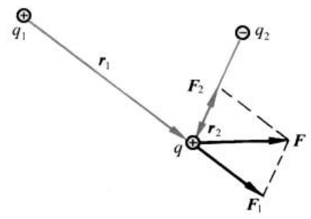

# 第7章 静电场

> 非连续样本；缺页不补写。

# PDF 第 260 页

章节：第7章 静电场；节：7.3 电场和电场强度。印刷页码：244。

[原页截图](../assets/p0260.png)。文字和 LaTeX 为机器识别，引用前请核对原图。

244

[区域原图](../assets/p0260-b000.png)

第
喜
7
静电
场

[区域原图](../assets/p0260-b002.png)

此力约相当于10kg物体所受的重力。此例说明，在原子尺度内电力是非常强的。

[区域原图](../assets/p0260-b003.png)

库仑定律只讨论两个静止的点电荷间的作用力，当考虑两个以上的静止的点电荷之间
的作用时，就必须补充另一个实验事实：两个点电荷之间的作用力并不因第三个点电荷的

[区域原图](../assets/p0260-b004.png)

存在而有所改变。
因此，两个以上的点电荷对一个点电
荷的作用力等于各个点电荷单独存在时对该点电荷的作
用力的矢量和。这个结论叫电力的叠加原理。

[区域原图](../assets/p0260-b005.png)

**figure：原图保留，表格未重建**

?
91
92
F2
b
+
F

图7.4画出了两个点电荷q和q2对第三个点电荷q
的作用力的叠加情况。电荷q和q单独作用在电荷q
上的力分别为F和F2，它们共同作用在q上的力F就是
这两个力的合力，即

[区域原图](../assets/p0260-b007.png)

静电
力叠加原理

[区域原图](../assets/p0260-b008.png)

**公式待复核**

$$
F=F_{1}+F_{2}
$$

[区域原图](../assets/p0260-b009.png)

对于由n个点电荷q1，q2，，9组成的电荷系，若以F，F2，…，F分别表示它们单独
存在时对另一点电荷a上的电力，则由电力的叠加原理可知，q受到的总电力应为

[区域原图](../assets/p0260-b010.png)

复核记录：明显错误：求和上下限及各项下标识别错误。

**公式待复核**

$$
F=F_{1}+F_{z}+\cdots+F_{s}=\sum_{s=t}^{s}F,
$$

[区域原图](../assets/p0260-b011.png)

原书公式编号（人工核对）：7.4

(7
4

[区域原图](../assets/p0260-b012.png)

在q，q2，，q和q都静止的情况下，F都可以用库仑定律式（7.3）计算，因而可得

[区域原图](../assets/p0260-b013.png)

复核记录：明显错误：单位矢量下标识别错误。

**公式待复核**

$$
{\cal F}=\sum_{i=1}^{n}\,\frac{q q_{i}}{4\pi\varepsilon_{0}\,r_{i}^{2}}e_{0\,0}\,,
$$

[区域原图](../assets/p0260-b014.png)

原书公式编号（人工核对）：7.5

(7
5

[区域原图](../assets/p0260-b015.png)

式中，r为q与q：之间的距离，e为从点电荷q：指向q的单位矢量。

[区域原图](../assets/p0260-b016.png)

## 电
场和电
电
场强
度
3

[区域原图](../assets/p0260-b017.png)

设相对于惯性参考系，在真空中有一固定不动的点电荷系9，92，，9n。将另一点电荷
q移至该电荷系周围的P（x，y，z）点（称场点）处，现在求a受该电荷系的作用力。这力应该
由式（7.5）给出。由于电荷系作用于电荷q上的合力与电荷q的电量成正比，所以比值F/q
只取决于点电荷系的结构（包括每个点电荷的电量以及各点电荷之间的相对位置）和电荷9
所在的位置（x，y，z），而与电荷g的量值无关。因此，可以认为比值F/a反映了电荷系周围
空间各点的一种特殊性质，它能给出该电荷系对静止于各点的其他电荷9的作用力。这时
就说该点电荷系周围空间存在着由它所产生的电场。电荷9，92，，9叫场源电荷，而比
值F/g就表示电场中各点的强度，叫电场强度（简称场强）。通常用E表示电场强度，于是
就有定义

[区域原图](../assets/p0260-b018.png)

**公式待复核**

$$
E={\frac{F}{q}}\,
$$

[区域原图](../assets/p0260-b019.png)

原书公式编号（人工核对）：7.6

(7
6

[区域原图](../assets/p0260-b020.png)

此式表明，电场中任意点的电场强度等于位于该点的单位正电荷所受的电力。在电场中各
点的E可以各不相同，因此一般地说，E是空间坐标的矢量函数。在考察电场时，式（7.6）
中的a起到检验电场的作用，叫检验电荷。

[区域原图](../assets/p0260-b021.png)

在国际单位制中，电场强度的单位名称为牛每库，符号为N/C。以后将证明，这个单位
和V/m是等价的，即

[区域原图](../assets/p0260-b022.png)

