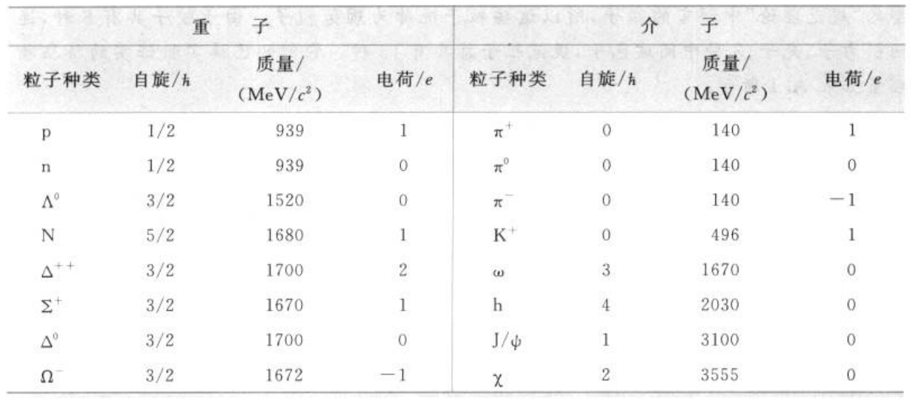
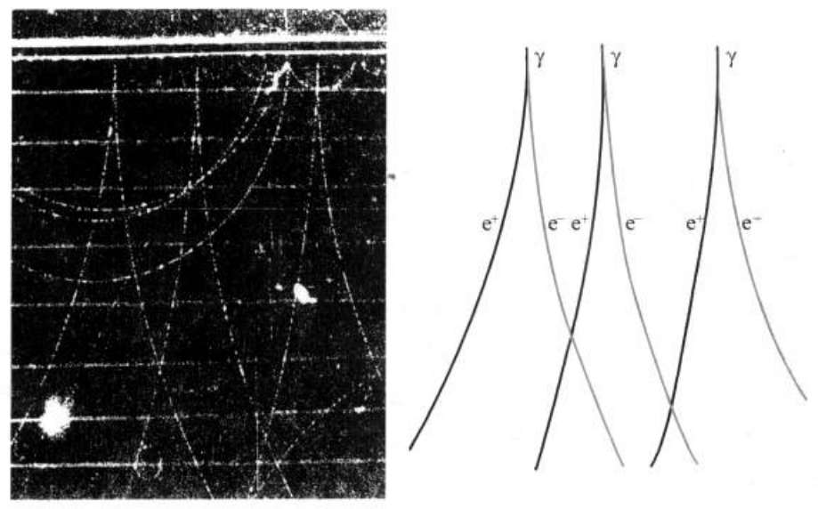

# PDF 第 20 页

章节：今日物理趣闻A 基本粒子；节：A.3 粒子的转化与守恒定律。印刷页码：4。

[原页截图](../assets/p0020.png)。文字和 LaTeX 为机器识别，引用前请核对原图。

今日物理趣闻A
基本粒子

[区域原图](../assets/p0020-b000.png)

表
3
些强
A.
子

[区域原图](../assets/p0020-b001.png)

**table：原图保留，表格未重建**

重
子
介
子
质量/
质量/
粒子种类
自旋/h
电荷/e
粒子种类
自旋/h
电荷/e
(MeV/c)
(MeV/e)
p
1/2
939
1
π
0
140
1
1/2
939
0
0
140
n
oV
3/2
1520
0
0
140
1
N
5/2
1680
K+
0
496
3/2
1700
2
3
1670
0
3/2
1670
1
h
4
2030
O
△°
3/2
1700
0
J/4
1
3100
0
3/2
1672
-1
2
3555
X

## 粒子的转化与守恒定律
A3

[区域原图](../assets/p0020-b003.png)

研究各种粒子的行为时，发现的另一个重要事实是：没有一种粒子是不生不灭、永恒不
变的，在一定的条件下都能产生和消灭，都能相互转化，毫无例外。例如，电子遇上正电子，
就会双双消失而转化为光子。反过来高能光子在原子核的电场中又能转化为一对电子和正
电子（图A.1）。在缺中子同位素中，质子会转化为中子而放出一个正电子和一个中微子。
质子遇上反质子就会相互消灭而转化为许多介子。π介子和原子核相互碰撞，只要能量足
够高，就能转化为一对质子和反质子。前面所提到的粒子衰变也是一种粒子转化的方式。
因此，产生和消灭是粒子相互作用过程中非常普遍的现象。

[区域原图](../assets/p0020-b004.png)

**figure：原图保留，表格未重建**

e

图
X光的光子由上方人射，经过铅板后，产生
电子-正电子对的径迹照片与分析图

[区域原图](../assets/p0020-b006.png)

