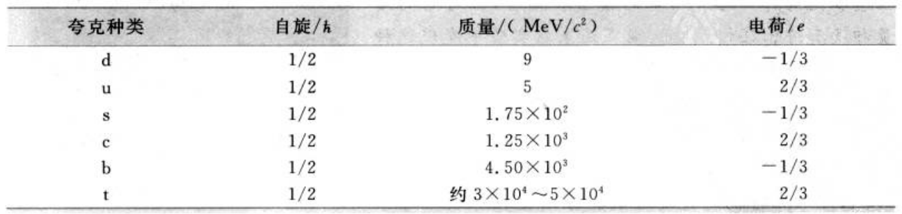

# PDF 第 21 页

章节：今日物理趣闻A 基本粒子；节：A.4 夸克。印刷页码：5。

[原页截图](../assets/p0021.png)。文字和 LaTeX 为机器识别，引用前请核对原图。

[区域原图](../assets/p0021-b000.png)

5

[区域原图](../assets/p0021-b001.png)

A
克
4

[区域原图](../assets/p0021-b002.png)

实验证明，在粒子的产生和消灭的各种反应过程中，有一些物理量是保持不变的。这些
守恒量有能量、动量、角动量、电荷，还有轻子数、重子数、同位旋、奇异数、宇称等。例如，对
于中子衰变为质子的β衰变反应

[区域原图](../assets/p0021-b003.png)

**公式待复核**

$$
\mathbf{n}{\stackrel{\rightarrow}{\longrightarrow}}\,\mathbf{p}+\mathbf{e}+\nu,
$$

[区域原图](../assets/p0021-b004.png)

所涉及的粒子，中子n和反中微子ve的电荷都是零，质子p的电荷为1，电子e的电荷
为一1，显然衰变前后电荷（的代数和）是守恒的。此反应中n和p的重子数都是1，轻子数
都是0；而e和ve的重子数都是0，前者的轻子数为1，后者的轻子数为一1；也很容易看出这
一衰变前后的重子数和轻子数也都是守恒的。同位旋、奇异数和宇称等的概念比较抽象，此
处不作介绍。但可以指出，它们有的只在强相互作用引起的反应（这种反应一般较快）中才
守恒，而在弱相互作用或电磁相互作用引起的反应（这种反应一般较慢）中不一定守恒。它
们不是绝对的守恒量。

[区域原图](../assets/p0021-b005.png)

## 奈
克
4

[区域原图](../assets/p0021-b006.png)

强子种类这样多，很难想象它们都是“基本的”，它们很可能都有内部结构。前面已讲
过，利用高能粒子撞击质子使之破碎的方法考查质子的结构是不成功的，但有些精确的实验
还是给出了一些质子结构的信息。1955年，霍夫斯塔特曾用高能电子束测出了质子和中子
的电荷和磁矩分布，这就显示了它们有内部结构。1968年，在斯坦福直线加速器实验室中
用能量很大的电子轰击质子时，发现有时电子发生大角度的散射，这显示质子中有某些硬核
的存在。这正像当年卢瑟福在实验中发现原子核的结构一样，显示质子或其他强子似乎都
由一些更小的颗粒组成。

[区域原图](../assets/p0021-b007.png)

粒子组成的模型。这些理论中最成功的是1964年盖尔曼和茨威格提出的，他们认为所有的
强子都由更小的称为“夸克”（在中国有人叫做“层子”）的粒子所组成。将强子按其性质分
类，发现强子形成一组一组的多重态，就像化学元素可以按照周期表形成一族一族一样。从这
种规律性质可以推断：现在实验上发现的强子都是由6种夸克以及相应的反夸克组成的。它
们分别叫做上夸克u、下夸克d、夸克c、奇异夸克s、顶夸克t、底夸克b，它们的特征物理量如
表A.4所示。值得注意的是它们的自旋都是1/2，而电荷量是元电荷e的一1/3或2/3。

[区域原图](../assets/p0021-b008.png)

表
A.
4
夸克

[区域原图](../assets/p0021-b009.png)

**table：原图保留，表格未重建**

夸克种类
自旋/
质量/（MeV/c²）
电荷/e
d
1/2
6
-1/3
1/2
2/3
n
1/2
1.75X10²
-1/3
1/2
1.25X103
2/3
C
b
1/2
4.50X103
-1/3
1/2
约3×104~5×10
2/3

在强子中，重子都由3个夸克组成，而介子则由1个夸克和1个反夸克组成。例如，质
子由2个u夸克和1个d夸克组成，中子由2个d夸克和1个u夸克组成，粒子由2个u
夸克和1个奇异夸克组成；而π介子由1个u夸克和1个反d夸克组成，K+介子由1个u

[区域原图](../assets/p0021-b011.png)

