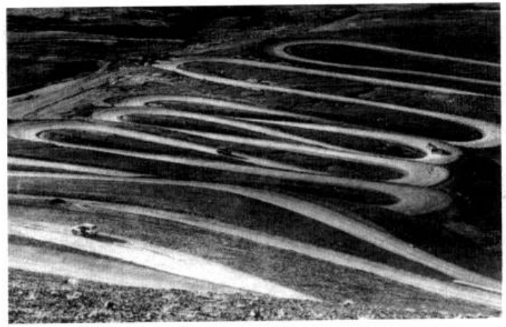

# PDF 第 29 页

章节：第1章 质点运动学；节：1.1 参考系。印刷页码：待核对。

[原页截图](../assets/p0029.png)。文字和 LaTeX 为机器识别，引用前请核对原图。

1
第
章

[区域原图](../assets/p0029-b000.png)

## 质
动
学
运

[区域原图](../assets/p0029-b001.png)

典力学是研究物体的机械运动的规律的。为了研究，首先描述。力学中描述物体运动
的内容叫做运动学。实际的物体结构复杂，大小各异，为了从最简单的研究开始，引进
质点模型，即以具有一定质量的点来代表物体。本章讲解质点运动学。相当一部分概念和
公式在中学物理课程中已学习过了，本章将对它们进行更严格、更全面也更系统化的讲解。
例如强调了参考系的概念，速度、加速度的定义都用了导数这一数学运算，还普遍加强了矢
量概念。又例如圆周运动介绍了切向加速度和法向加速度两个分加速度。最后还介绍了同
一物体运动的描述在不同参考系中的变换关系
伽利略变换。

[区域原图](../assets/p0029-b002.png)

## 参
尔
S

[区域原图](../assets/p0029-b003.png)

现在让我们从一般地描述质点在三维空间中的运动开始。

[区域原图](../assets/p0029-b004.png)

物体的机械运动是指它的位置随时间的改变。位置总是相对的，这就是说，任何物体的
位置总是相对于其他物体或物体系来确定的。这个其他物体或物体系就叫做确定物体位置
时用的参考物。例如，确定交通车辆的位置时，我们用固定在地面上的一些物体，如房子或
路牌作参考物（图1.1）。

[区域原图](../assets/p0029-b005.png)

**figure：原图保留，表格未重建**

图11
汽车行进在“珠峰公路”上（新华社）。在路径已经确定的情况下，汽车
的位置可由离一个指定的路牌的路径长度确定

[区域原图](../assets/p0029-b007.png)

