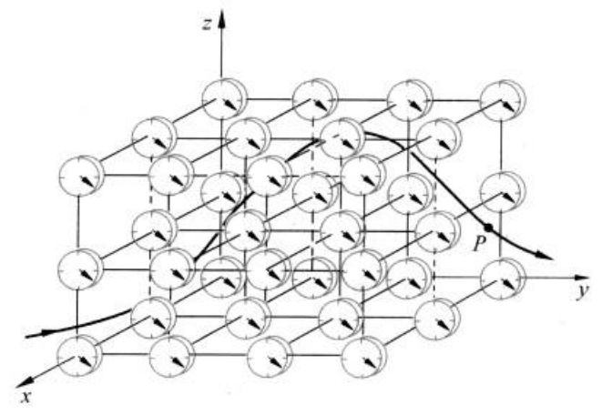

# PDF 第 30 页

章节：第1章 质点运动学；节：1.1 参考系。印刷页码：14。

[原页截图](../assets/p0030.png)。文字和 LaTeX 为机器识别，引用前请核对原图。

1
4

[区域原图](../assets/p0030-b000.png)

第
章
质
1
点
运
动
学

[区域原图](../assets/p0030-b001.png)

经验告诉我们，相对于不同的参考物，同一物体的同一运动，会表现为不同的形式。例
如，一个自由下落的石块的运动，站在地面上观察，即以地面为参考物，它是直线运动。如果
在近旁驰过的车厢内观察，即以行进的车厢为参考物，则石块将作曲线运动。物体运动的形
式随参考物的不同而不同，这个事实叫运动的相对性。由于运动的相对性，当我们描述一个
物体的运动时，就必须指明是相对于什么参考物来说的。

[区域原图](../assets/p0030-b002.png)

确定了参考物之后，为了定量地说明一个质点相对于此参考物的空间位置，就在此参考
物上建立固定的坐标系。最常用的坐标系是笛卡儿直角坐标系。这个坐标系以参考物上某
一固定点为原点0，从此原点沿3个相互垂直的方向引3条固定在参考物上的直线作为坐
标轴，通常分别叫做x，y，轴（图1.2）。在这样的坐标系中，一个质点在任意时刻的空间位
置，如P点，就可以用3个坐标值（x，y，）来表示。

[区域原图](../assets/p0030-b003.png)

**figure：原图保留，表格未重建**

P
y
X

图1.2
一个坐标系和一套同步的钟构成一个参考系

[区域原图](../assets/p0030-b005.png)

质点的运动就是它的位置随时间的变化。为了描述质点的运动，需要指出质点到达各
个位置（x，y，）的时刻t。这时刻t是由在坐标系中各处配置的许多同步的钟（如图1.2，在
任意时刻这些钟的指示都一样）给出的。质点在运动中到达各处时，都有近旁的钟给出它
到达该处的时刻t。这样，质点的运动，亦即它的位置随时间的变化，就可以完全确定地描
述出来了。

[区域原图](../assets/p0030-b006.png)

一个固定在参考物上的坐标系和相应的一套同步的钟组成一个参考系。参考系通常以
所用的参考物命名。例如，坐标轴固定在地面上（通常一个轴竖直向上）的参考系叫地面参
考系（图1.3中O""y”）；坐标原点固定在地心而坐标轴指向空间固定方向（以恒星为基
准）的参考系叫地心参考系（图1.3中Oxy）；原点固定在太阳中心而坐标轴指向空间固
定方向（以恒星为基准）的参考系叫太阳参考系（图1.3中Oxyz）。常用的固定在实验室的
参考系叫实验室参考系。

[区域原图](../assets/p0030-b007.png)

质点位置的空间坐标值是沿着坐标轴方向从原点开始量起的长度。在国际单位制SI

[区域原图](../assets/p0030-b008.png)

①
此处说的“在坐标系中各处配置的许多同步的钟”是一种理论的设计，实际上当然办不到。实际上是用一个钟随同物
体一起运动，由它指出物体到达各处的时刻。这只运动的钟事前已和静止在参考系中的一只钟对好，二者同步。这
样前者给出的时刻就是本参考系给出的时刻。实际的例子是飞行员的手表就指示他到达空间各处的时刻，这和地面
上控制室的钟给出的时刻是一样的。不过，这种实际操作在物体运动速度接近光速时将失效，在这种情况下运动的
钟和静止的钟不可能同步，其原因参见本书8.3节。

[区域原图](../assets/p0030-b009.png)

