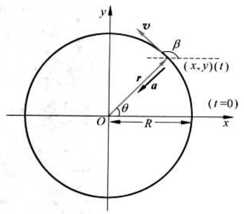

# PDF 第 40 页

章节：第1章 质点运动学；节：1.3 加速度。印刷页码：24。

[原页截图](../assets/p0040.png)。文字和 LaTeX 为机器识别，引用前请核对原图。

24

[区域原图](../assets/p0040-b000.png)

第
1
章
质
运
动
学

[区域原图](../assets/p0040-b001.png)

例
1
2

[区域原图](../assets/p0040-b002.png)

一质点在xy平面内运动，其运动函数为r=Rcoswt和y=Rsinwt，其中R和为正值
常量。求质点的运动轨道以及任一时刻它的位矢、速度和加速度。

[区域原图](../assets/p0040-b004.png)

解对x，y两个函数分别取平方，然后相加，就可以消去t而得轨道方程

[区域原图](../assets/p0040-b005.png)

复核记录：明显错误：原图平方上标被识别为 t。

**公式待复核**

$$
x^{t}+y^{t}=R^{t}
$$

[区域原图](../assets/p0040-b006.png)

这是一个圆心在原点，半径为R的圆的方程（图1.12）。它表明质点沿此圆周运动。

[区域原图](../assets/p0040-b007.png)

质点在任一时刻的位矢可表示为

[区域原图](../assets/p0040-b008.png)

**figure：原图保留，表格未重建**

B
（x.y)（）
(1=0)
R
X

复核记录：矢量粗体丢失，等号候选为 equiv，须核对。

**公式待复核**

$$
r=x i+y j\equiv R\mathrm{cos}\,\omega t i+R\mathrm{sin}\,\omega t j
$$

[区域原图](../assets/p0040-b010.png)

此位矢的
为大小
为

[区域原图](../assets/p0040-b011.png)

复核记录：根号及平方结构与原图相符；仍未作为全局可信公式验收。

**公式待复核**

$$
r=\ \sqrt{x^{2}+y^{2}}=R
$$

[区域原图](../assets/p0040-b012.png)

以0表示此位矢和x轴的夹角，则

[区域原图](../assets/p0040-b013.png)

复核记录：分式与三角函数结构与原图相符；仍保留复核状态。

**公式待复核**

$$
\tan\theta={\frac{y}{x}}={\frac{\sin\omega t}{\cos\omega t}}=\tan\omega t
$$

[区域原图](../assets/p0040-b014.png)

因而

[区域原图](../assets/p0040-b016.png)

**公式待复核**

$$
\theta=\,\omega t
$$

[区域原图](../assets/p0040-b017.png)

质点在任一时刻的速度可由位天表示式求出，即

[区域原图](../assets/p0040-b018.png)

复核记录：明显错误：速度表达式第二项漏识 cos 等内容。

**公式待复核**

$$
v\,=\,{\frac{\mathrm{d}r}{\mathrm{d}t}}=-\,R\,\omega\sin\omega t i+R\,\omega r i j
$$

[区域原图](../assets/p0040-b019.png)

图
例
1
用图

[区域原图](../assets/p0040-b020.png)

它沿两个坐标轴的分量分别为

[区域原图](../assets/p0040-b021.png)

复核记录：明显错误：第二个分量下标 y 识别为 *。

**公式待复核**

$$
v_{x}=-\,R\omega\sin\omega t\;,\quad v_{*}\,=\,R\omega\cos\omega t
$$

[区域原图](../assets/p0040-b022.png)

速率为

[区域原图](../assets/p0040-b023.png)

复核记录：明显错误：根号内第二个下标 y 识别成 x。

**公式待复核**

$$
v=\textstyle{\sqrt{v_{x}^{2}+v_{x}^{2}}}=R\omega
$$

[区域原图](../assets/p0040-b024.png)

由于是常量，表明质点作匀速圆周运动

[区域原图](../assets/p0040-b025.png)

以β表示速度方向与x轴之间的夹角，则

[区域原图](../assets/p0040-b026.png)

复核记录：明显错误：分式上下标识别错误。

**公式待复核**

$$
\tan\beta={\frac{v_{x}}{v_{r}}}=-\;{\frac{\cos\omega t}{\sin\omega t}}=-\;{\cot\omega t}
$$

[区域原图](../assets/p0040-b027.png)

从
而
有

[区域原图](../assets/p0040-b028.png)

复核记录：明显错误：末尾多识别 alpha。

**公式待复核**

$$
\beta=\omega t+{\frac{\pi}{2}}=\theta+{\frac{\pi}{2}}\quad\alpha
$$

[区域原图](../assets/p0040-b029.png)

明，速度在任何时刻总与位天垂直，即沿着圆的切线方向。质点在任一时刻的加速度

[区域原图](../assets/p0040-b030.png)

复核记录：明显错误：矢量分量与 t 出现错识。

**公式待复核**

$$
a={\frac{\mathrm{d}v}{\mathrm{d}t}}=-\,R\omega^{2}\cos\omega\bar{u}-R\omega^{2}\sin\omega\bar{t}\,,
$$

[区域原图](../assets/p0040-b031.png)

而

[区域原图](../assets/p0040-b032.png)

复核记录：明显错误：加速度分量下标识别错误。

**公式待复核**

$$
a_{r}=-\,R\,\omega^{2}\cos\,\omega t\;\mathrm{,}\quad a_{\star}=-\,R\,\omega^{2}\sin\omega t
$$

[区域原图](../assets/p0040-b033.png)

此加速度的大小为
为

[区域原图](../assets/p0040-b035.png)

复核记录：明显错误：根号内第二个下标 y 识别成 x。

**公式待复核**

$$
a\,=\,\sqrt{a_{x}^{2}+a_{x}^{2}}=R\omega^{2}
$$

[区域原图](../assets/p0040-b036.png)

又由上面的位矢表示式还可得

[区域原图](../assets/p0040-b037.png)

**公式待复核**

$$
a=-\,\omega^{2}\,(R\mathrm{cos}\;\omega t i+R\mathrm{sin}\;\omega t j\,)\,=-\,\omega^{2}\,r
$$

[区域原图](../assets/p0040-b038.png)

这一负号表示在任一时刻质点的加速度的方向总和位矢的方向相反，也就是说匀速率圆周运动的加速度
总是沿着半径指向圆心的。

[区域原图](../assets/p0040-b039.png)

本题给出的x，y两个函数式，实际上表示的是沿x和y方向的两个简谐振动。本题的分析结果指出，
这两个振动的合成是一个匀速圆周运动，它有一个向心加速度，其大小为R。

[区域原图](../assets/p0040-b040.png)

